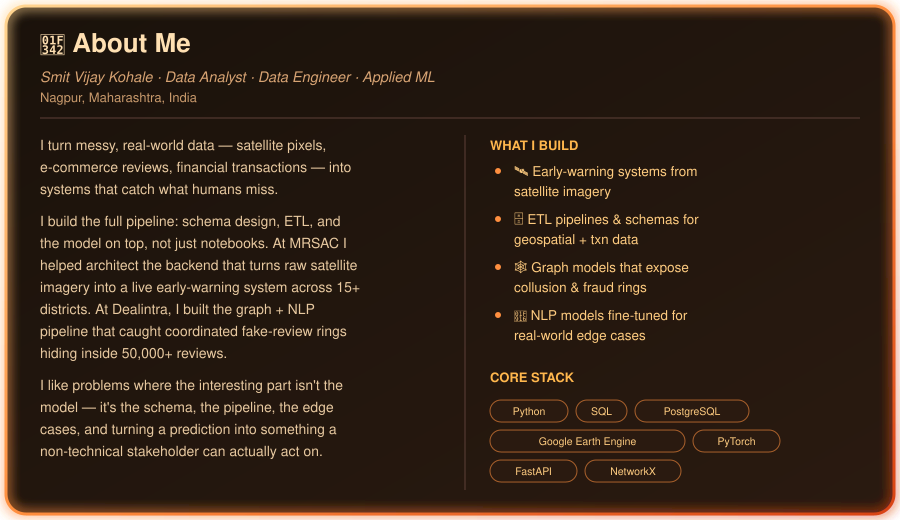
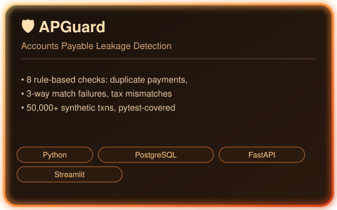
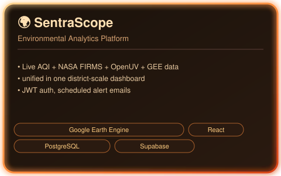
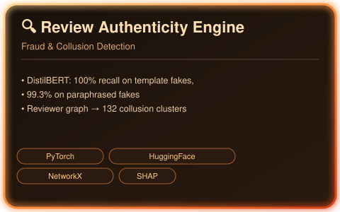
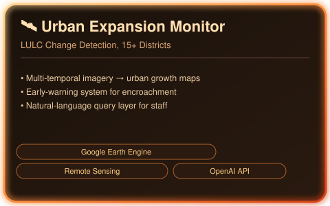

<!-- ============================================================ SMIT KOHALE — AUTUMN-THEMED GITHUB PROFILE README ============================================================ -->

  

  

  
  
  
  

  <h2>About Me</h2>

  

  <h2>Tech Stack</h2>

  
  
  
  
  
  
  
  
  
  
  
  
  
  
  
  
  
  
  

  <h2>Featured Projects</h2>

Click any card to open the repo.

<table align="center">
  <tr>
    <td width="50%" valign="top" align="center">
      
    </td>
    <td width="50%" valign="top" align="center">
      
    </td>
  </tr>
  <tr>
    <td width="50%" valign="top" align="center">
      
    </td>
    <td width="50%" valign="top" align="center">
      
    </td>
  </tr>
</table>

  

  <h2>Certifications</h2>

  <ul style="list-style-type:none; padding-left:0;">
    <li><strong>Ask Questions to Make Data-Driven Decisions</strong> — Coursera (Oct 2025)</li>
    <li><strong>Big Data Computing</strong> — NPTEL (IIT), 78%</li>
  </ul>

  <h2>Connect With Me</h2>

  
  
  

  

